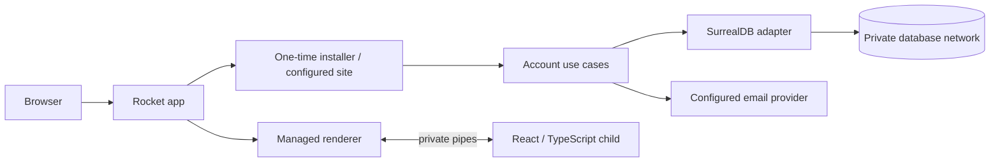

# Architecture and code map

## Runtime and ownership

Compose runs two services: the public Rust app and SurrealDB 3.3.1. Only the app's
website port is published. SurrealDB uses a dedicated internal network shared with
the app and never has a host port mapping. Fresh-volume ownership is prepared in
the images, so neither an initializer service nor operator database credentials
are needed. The database trusts this private network; see security.md.

The app owns a Node child that server-renders React from strict TypeScript sources.
Rust and Node exchange bounded JSON-lines through stdin/stdout, with startup and
request timeouts. There is no renderer listener, service, port, or bearer token.
The app starts it before serving, restarts it on the next render after failure,
and kills/reaps it on shutdown. The child inherits only PATH and receives scoped
page props (public branding, own-account settings, or authorized administrator data); it is trusted application code, not an extension sandbox.

## Crates and important logic

| Crate | Owns | Important locations |
| --- | --- | --- |
| `artismaga-core` | Infrastructure-independent contracts | `crates/core/src/lib.rs`: permission vocabulary, policies, public user DTO, email canonicalization, Gravatar |
| `artismaga-config` | Settings and persistence | `crates/config/src/lib.rs`: bootstrap defaults, load/validate/save, private atomic TOML writes, setup Origin matching |
| `artismaga-db` | SurrealDB protocol and fixed transactions | `crates/db/src/lib.rs`: bound RPC queries, optional auth, migration; `schema.surql`: original schema; `installation.surql`: additive installer schema; `account_settings.surql`: profile/preferences/configuration and session metadata; `studio.surql`: work/media/provider/role revision schema; `creative.surql`: taxonomy/work-details/cover retirement; `queries/`: account and installation SQL |
| `artismaga-auth` | Account/security use cases | `crates/auth/src/lib.rs`: Argon2id pool, credentials, permissions, email tokens, first-owner installation; `queries/install.surql` in db: owner/policy/claim transaction |
| `artismaga-accounts` | Own-account profile/preferences and deletion | `crates/accounts/src/lib.rs`: bounded settings validation, revision checks, private defaults, own-account DTO and password-confirmed deletion |
| `artismaga-administration` | Site configuration and account directory | `crates/administration/src/lib.rs`: branding/colour/default cover and registration policy; `roles.rs`: protected role validation, role CRUD and revisions; `taxonomy.rs`: genre/subgenre policy and curated tag seeds; directory returns only public user DTOs |
| `artismaga-storage` | Private artwork and encrypted providers | `crates/storage/src/lib.rs`: providers/upload/read/cleanup; `images.rs`: safe decode/resize/palette; `vault.rs`: owner-private encryption key and credential envelope |
| `artismaga-studio` | Private works, collaboration and explicit public catalogue snapshots | `crates/studio/src/lib.rs`: accessible catalogue/metadata/access; `details.rs`: chapter hierarchy/archive/classification/disclosures; `collaboration.rs`: batch grants/name search; fixed transactions in db `queries/studio_*.surql` |
| `artismaga-setup` | Installation orchestration | `crates/setup/src/lib.rs`: private claim-code creation/checking, existing-site detection, validated configuration staging, file locking and one-time installation |
| `artismaga-render` | Renderer process lifecycle and IPC | `crates/render/src/lib.rs`: child spawn, handshake, bounded frames, serialization, timeout/crash cleanup, shutdown/reaping |
| `artismaga-web` | HTTP routes and transport security | `crates/web/src/lib.rs`: configured account/admin/page APIs; `installation.rs`: unconfigured-only surface and handover; `security.rs`: shared bounded peer throttling; `pages.rs`: scoped DTOs/nonces; `studio.rs`: work routes, bounded upload and private media; `administration.rs`: configuration/roles/storage transport; `vocabulary.rs`: safe suggestions/taxonomy |
| `artismaga` | Executable composition | `crates/app/src/main.rs`: startup mode, explicit setup-code output, schema/cleanup commands, installer-to-site listener handover, renderer lifecycle, periodic cleanup |

Every crate has a maintained README. Domain contracts do not import adapters.
Password and installation logic are outside HTTP handlers. The database adapter
owns its transport and reviewable transaction SQL. Add repository traits when a
second adapter makes that useful rather than substituting fake persistence in
production.

## Frontend and packaging map

| Location | Responsibility |
| --- | --- |
| `web/src/shared/contracts.ts` | Runtime SSR schemas, inferred DTO types, API/setup contracts |
| `web/src/components/` | Document shell and accessible shared form controls |
| `web/src/pages/` | React home/account/admin pages and four-step setup form |
| `web/src/server/render.tsx` | Validated page dispatch and React escaping |
| `web/src/server/worker.ts` | Private bounded JSON-lines worker, no HTTP |
| `web/src/components/Appearance.tsx` | Live theme/accessibility/base-colour context; Application applies scheme and root accessibility attributes |
| `web/src/pages/studio/` | Work catalogue, creation, editable identity/artwork, chapter hierarchy/archive, classification/disclosures, batch share controls and planned related/analytics tabs |
| `web/src/client/navigation.ts` | Path tabs with server-selected initial section and browser Back/Forward |
| `web/src/client/` | Validated document hydration and typed API submissions; React page modules own interactions |
| `web/src/theme/theme.ts`, `web/src/styles/` | Mantine defaults, semantic Material roles, responsive layout and accessibility preferences |
| `web/tests/` | SSR/contracts/client validation and worker protocol regression tests |
| `Dockerfile`, `Dockerfile.database`, `compose.yaml` | Built TypeScript + Rust app, non-root persistent data, two-service isolation |
| `scripts/test-integration.sh` | Disposable integration image/network with no database port mapping |

See web/README.md for the module guide. TypeScript strictness, unchecked-index and
exact-optional checks, runtime boundary validation, and formatting are enforced.
React hydrates the complete server-rendered document with validated DTOs and the same
Mantine provider/theme. No account secrets or bearer credentials are serialized.
Only profile/settings pages carry the authenticated owner’s email and settings;
administrator data requires server authorization. Mantine style blocks carry a
per-response CSP nonce; executable inline scripts remain forbidden. Build web/dist before Cargo so Rocket
can embed the generated browser JavaScript. Generated outputs are ignored.

## Installation state machine

On a fresh database with no saved config, only the setup/health/assets surface is
mounted. No login, registration, or admin routes exist yet. A private persisted
256-bit code authorizes installation; browser Origin must match Host and direct-peer
rate limits apply. The code is retrieved explicitly through the app, never HTML,
URLs, or logs. The wizard collects branding, external origin, signup policy,
first-owner details, and optional SMTP settings, then reviews non-secret choices.

After validation the installer locks configuration writers, atomically stages a
private TOML file, then creates the first owner, signup policy, and permanent DB
claim marker in one transaction. Repeated/concurrent claims cannot replace an
administrator. A crash before the transaction can retry with the same code; a crash
after it recovers from the saved configuration. Existing administrators also close
setup for older databases. Existing accounts with missing config fail startup and
require restoration, not another setup. Both volumes must be backed up together.

The successful installer response briefly precedes listener shutdown. The app
reloads settings, retains the managed renderer, and launches the configured site
on the same port. The browser waits for readiness and opens sign-in. Setup routes
are not mounted in this mode; restarting never reopens them.

## Account/data invariants

Accounts have unique canonical email and random UUIDs with `usr_` prefixes (avoiding
SurrealDB JSON UUID inference). New readers cannot supply a role. Unknown groups
confer no permissions; capabilities require verification. The explicitly claimed
first owner is verified. Permission checks resolve current persisted groups.

Registration checks policy and consumes invitations atomically with account creation.
Unique email constraints close duplicate races, and failure rolls back invitation
consumption. Sessions use random opaque cookies and SHA-256 digests at rest, expire
after seven days, and support current/all-session revocation. Verification/reset
tokens expire after 30 minutes; invitations after seven days. Reset consumes its
token and revokes all sessions atomically. Login rechecks the password hash during
session creation so a concurrent reset cannot issue a stale-password session.
Expiry is checked on lookup even when hourly cleanup fails.

SurrealQL values are bound separately from query text. Only validated configured
namespace/database identifiers are interpolated. The original baseline migration
remains idempotent; installation schema is a separate additive migration. General
versioned upgrade tooling remains planned; do not mutate deployed baseline fields
to simulate an upgrade. Preserve operator settings during seed/migration.

## Future domain boundaries (not implemented)

| Planned crate/module family | Roadmap ownership |
| --- | --- |
| `catalog` / Studio extensions | Public story metadata, franchises, series, volumes and profiles; private Book metadata begins in Studio |
| `publishing` (partially implemented in Studio) | Scheduling, worldbuilding and reviewer preview links remain planned; explicit public catalogue and chapter-body snapshots are implemented |
| `discovery` (partially implemented in web/Studio) | Ranking, personal recommendations and indexed search; featured catalogues, genre views and mature-content exclusions are implemented |
| `library` | Bookmarks and full library remain planned; chapter position sync, account export and explicit offline downloads are implemented in reader.rs |
| `community` | Written reviews, follows, blocks and moderation workflows remain planned; chapter comments, notification mutes and an in-site inbox are implemented in community.rs; chapter reactions/ratings are implemented in reader.rs |
| `notifications` (in-site foundation implemented in Studio) | Subscription preferences, email/push alerts, RSS/Atom remain planned |
| `billing` | Stripe checkout, subscriptions, receipts, entitlement decisions, signed webhook handling |
| `moderation` | Reports, cases, sanctions, audit history, anti-abuse policies |
| `analytics` | Privacy-conscious event ingestion, aggregate reporting, ranking inputs, CSV exports |
| `jobs` | Publication schedules, retries, email dispatch, indexing and background monitoring |
| `providers` / `extensions` | Email/storage/payment adapters and separately sandboxed JavaScript extensions |
| `administration` (partially implemented) | Extend current site policy/branding with taxonomy, operational tools, import/export and localisation settings |

The storage and Studio portions above are implemented; remaining boundaries are ownership guidance, not empty crates. Split further when real code
requires independent responsibilities; do not introduce crate cycles. Keep shared
identifiers/contracts small, authorize commands in their owning domain, and record
important logic locations here as implementation grows. The full feature list
remains in planned_features.md rather than being reduced to this ownership table.

## Settings ownership and safety

Profile and preference records are keyed by the authenticated UID, never a caller-supplied owner.
Profile, preferences, and site configuration writes use transactional revision checks; stale
submissions return 409. Password changes and confirmed email changes revoke all sessions
and account tokens. Account deletion requires the current password and DELETE; deletion
and group reassignment protect the last administrator inside the database transaction.
Account export excludes password hashes, token digests and credentials. See account_settings.md
for which preferences are active versus reserved for future domain implementations.

## Live appearance, paths and Studio

Account settings tabs use `/account/settings/<section>` and administration tabs use
`/admin/<section>`. Rocket validates section names and React initializes from that
section before hydration. Tab changes use history pushState and handle popstate,
preserving mounted form drafts. Utility destinations are only in the account menu.
A small Appearance context immediately previews theme, base colour and visual
accessibility changes; Save persists preferences/configuration with revisions.
The theme derives accessible tones from a configurable colour and resolves action
contrast per scheme. CSP still permits only nonce-scoped style blocks and same-origin scripts.

Studio returns scoped work DTOs; no private catalogue data is sent on public pages.
Art references are generated IDs, not caller URLs or filesystem paths. Storage's
public settings DTO has no credential fields; encrypted providers remain in Rust.
See studio_and_storage.md for ACLs, defaults, provider retention, export/deletion
and honest limitations of local versus cloud validation.

## Creative configuration

See chapters_and_taxonomy.md for chapter state, taxonomy policy, asset ownership,
archive deadlines and limits. Each work has a separate revisioned `work_details`
document. Its transaction also writes the work row, so a collaborator removal
conflicts with an in-flight edit. Covers are checked and touched transactionally
against retirement; expired cover claims are durable and storage deletion retries.
Taxonomy is administration-owned and reused by Studio and HTTP suggestions.
Suggestion DTOs never include emails or draft titles. The renderer accepts at most
2 MiB input / 8 MiB output; each work's configuration is bounded to 1 MB/2,000 nodes.
Page titles share one SSR/client helper; semantic neutral and surface colours share
the administrator's seed in both schemes rather than hardcoded green backgrounds.

## Localisation boundary

`artismaga-localisation` owns the dot-key catalogue and draft/live overrides
(`src/lib.rs`, `edit.surql`), managed local inference (`runtime.rs`) and encrypted
provider/cache policy (`translation.rs`). `db/src/localisation.surql` owns their
schema and work translation records. `web/src/localisation.rs` authorises editor
mutations; `web/src/pages.rs` builds permission-filtered SSR bundles.
`web/src/localisation/index.tsx` supplies the shared SSR/hydration text context.
`studio/src/translations.rs`, `translation_save.surql` and
`translation_grants.surql` own language grants and source-bound approval, separately
from generic sharing. `web/src/pages/admin/Localisation.tsx` and
`pages/studio/Translations.tsx` implement the editors. Auth selects published
localised account-email templates; app owns runtime warmup/shutdown and cache cleanup.

## Identity, announcements and operational analytics

`administration/src/identity.rs` validates declarative built-in Light/Dark/Sepia
options and public social links, persisted in the versioned site configuration.
`web/src/shared/theme-selection.ts` applies availability consistently to SSR and
hydration; administrators retain preview access. Site name/headline are source-
locale keys, edited through the same draft/publication API as other localisation.
`pages/admin/Identity.tsx` contains Site/Themes subnavigation; Configuration embeds
storage instead of treating it as a separate administration destination.

`administration/src/announcements.rs` owns notice/promotion validation, immutable
creator attribution, revision conflicts, schedules and audience evaluation.
`db/src/announcements.surql` defines private persistence. No delete operation erases
announcement history. `web/src/administration.rs` requires `manage_announcements`;
`web/src/pages.rs` filters public SSR audiences before serialisation and schedules
cached automated translations when enabled. `web/src/studio.rs` authorises image
uploads and audience-aware media reads. `components/Announcements.tsx` renders
severity icons, promotional artwork and per-revision dismissal; the administration
editor is `pages/admin/Announcements.tsx`.

`web/src/analytics.rs` owns bounded aggregate counters, latency samples and safe
OS sensor reads. It records no IPs, user agents or reading histories. Dedicated
`/analytics/:tab` pages and `/api/analytics/live` require `view_analytics`;
administrators receive this derived permission. Live metrics reset on app restart;
long-term audience/story/taxonomy, retention and billing reporting remain explicit
placeholders. `pages/admin/Performance.tsx` provides the shared live status panel;
`SiteAnalytics.tsx` owns the dedicated analytics tabs.

`web/src/localisation/dates.ts` formats timestamps in the configured account/site
time zone for both SSR and hydration. The localisation DTO carries that zone and a
single render timestamp; implementation tokens such as `UTC` and `DELETE` remain
stable values, with confirmation tokens passed through named placeholders.
Announcement history uses `announcements::history` for searchable pagination and
`visible_list` for schedule/audience-filtered discovery, with batched attribution.

## Audience intent and administration presentation

`studio/src/details.rs::TargetAudience` owns bounded author-selected age ranges;
`Command::Audience` persists them using the existing editor/revision transaction.
`web/src/pages/studio/Audience.tsx` supplies the audience section inside the work
Overview tab; `/studio/<uid>/audience` remains a compatible alias for Overview. Older work
documents default to unspecified bounds without a migration. This is author intent,
separate from content disclosures, access control, or official classifications.

`admin/Roles.tsx` owns the role navigation and category editors; protected roles
remain immutable in the server and are disabled in the interface.
`components/Announcements.tsx` renders full-image promotions, including accessible
image-only destination links; URL validation remains in administration.

## Chapter writing

`studio/src/writing.rs` owns typed rich text, chapter notes/language, private draft
reads and immutable revision checkpoints. `db/src/writing.surql` is additive schema.
`studio/src/writing_save.surql` checks access, active chapter state and revision in
one transaction, touching the work row to serialize archive and share revocation.
The details update/purge transactions remove manuscripts only when a chapter is
actually removed after its recovery period. Account export/deletion include them.

`web/src/studio.rs` serves `/studio/<work>/chapters/<chapter>` and its private APIs.
The renderer still runs as the app’s managed child; no editor service is added.
`web/src/pages/studio/ChapterEditor.tsx` and `web/src/editor/` own the browser editor,
safe semantic SSR fallback, autosave/recovery, notes, revision comparison, paste
cleanup and basic local writing checks. See chapter_editor.md for guarantees and
limits. Work Overview puts synopsis first, then genres/tags and audience in one row.

The focused writer bypasses `Shell` in `Application.tsx`. `editor/selection.ts`
provides non-persistent selection/search decorations, `EditorDock.tsx` owns the
floating formatting/search actions, `InlineTitle.tsx` updates
chapter metadata with revision checks, and `AuthorNotes.tsx` owns the single outline,
left passage markers and passage-note dialog. Manuscripts carry `chapter_note`;
legacy unanchored notes are combined on load without losing text.

`editor/RevisionHistory.tsx` owns the two-step checkpoint table and bounded fetches;
`RevisionCanvas.tsx` supplies read-only manuscript surfaces. `revision-diff.ts` maps
bounded word differences to UTF-16 offsets consumed by the safe rich-text renderer,
preserving formatting without injecting HTML. Studio history batches current
editor avatar lookup after access checks and omits internal IDs/emails from DTOs.

## Publishing catalogue and discovery

`studio/src/publishing.rs` owns explicit public metadata/chapter-catalogue snapshots,
validation, chapter-catalogue timestamps and public artwork references. Fixed
`publish.surql`/`unpublish.surql` transactions serialize ownership, work/details
revisions and media lifetime; `db/src/publishing.surql` is an additive migration.
Private manuscripts and author notes stay in writing storage.

`web/src/discovery.rs` owns public genre/story routes, same-origin publication,
admin featuring and own-account recommendation exclusion transport. `pages.rs`
filters published summaries by private account content preferences before SSR; it
never exposes those preferences themselves. `pages/studio/Publishing.tsx` composes
the setup Stepper; `pages/Home.tsx` and `pages/discovery/` own catalogue, genre and
public story views. Account deletion removes publications before deleting artwork;
export includes owned snapshots. See publishing_discovery_progress.md for limits.

Publishing presentation refinements: `studio/src/schedule.rs` validates structured
expected-release rules and bundled IANA zone names. `shared/schedule.ts` calculates
calendar occurrences; `ReleaseSchedulePicker.tsx` edits them and
`ReleaseSchedulePanel.tsx` displays the viewer-local next occurrence/countdown.
Legacy free text is retained in storage but decoded as no recurrence. This does not
add a publication job. `Studio::public_status` projects snapshot status into private
work DTOs without changing raw draft-row visibility semantics.

`StoryMenu.tsx`, `StoryCard.tsx` and `FeaturedStories.tsx` share cover notices/actions
and separate compact shelves from a hover/focus-paused feature carousel. Shared mature overlays make covered links inert until dismissed; the carousel retains elapsed progress across pauses and animates directional entry/exit with reduced-motion support. Bundled
anime genre assets live under `crates/web/assets/genres`; `discovery::genre_art`
serves a fixed embedded filename list. `GenreButton.tsx` prefers uploaded taxonomy
imagery; page assembly projects only public image palettes, not provider records.

Transient UI feedback is owned by `web/src/components/Feedback.tsx` and the single
Mantine Notifications host in `Application.tsx`. Forms and page adapters report
translated action outcomes there; no server/domain notification delivery or
subscription behavior is implied. Feedback is ephemeral client state, with no
storage, IPC additions or permission authority. Story overview chapter artwork
shares the page's mature-notice dismissal state with its hero and cover.

## Reader and released chapter bodies

Studio `reader.rs` owns public body projection, account-scoped reading state,
reaction validation and revisioned reaction configuration; `chapter_publish.surql`
and `reader_save.surql` own the fixed transactions. `chapter_publish.surql` copies only
`Manuscript.document` plus language/release metadata into `chapter_publication`;
`publish.surql` exposes only active staged releases.
`db/src/reader.surql` is additive and does not rewrite existing snapshots. Old
catalogues show unavailable manuscripts until an explicit publication occurs.
`reader_state` is keyed by authenticated account/work/chapter and participates in
account export/deletion. Configured reaction artwork is site-owned data.

Web `reader.rs` owns public routes, same-Origin/session/capability guards and fixed
bundled Twemoji routes. `pages.rs` deliberately assembles anonymous reader props
regardless of session cookies, so explicit downloads never cache account data or
localisation drafts. Own-account state loads through a separate no-store API.
`web/src/pages/reader` owns the safe rich-text reader, settings, device progress,
conflict decisions and local speech synthesis. `assets/reader-sw.js` caches only
explicit public chapter downloads and their asset allowlist, never private APIs.
`pages/admin/Comments.tsx` owns draft reaction configuration and its mock preview.
See reader_progress.md for current limits, verification and remaining roadmap work.

## Reading measurements and story lifecycle

`studio/src/engagement.rs` owns deduplicated daily reading reports, public feedback
projections, scoped Studio analytics, recent reading states and Popular scoring.
`engagement_record.surql` serializes a viewer/day claim with its daily aggregate;
`reader_save.surql` updates current feedback aggregates in the same transaction as
account progress. `db/src/engagement.surql` is additive and backfills prior feedback
once. Account deletion subtracts current feedback and removes pseudonymous reports;
export format 7 includes the requesting account's reports and owned release/status data.

`studio/src/lifecycle.rs` owns revisioned status/hiatus validation, calendar-month
cutoffs and automatic abandonment. The app's existing hourly worker reads the
administration-owned optional policy and processes the 100 oldest ongoing stories.
The transaction rechecks status/latest release and touches the work revision, so
concurrent chapter publication or author status changes cannot be overwritten.
Staged chapter bodies remain private until work publication; public catalogues omit
unreleased chapters. Full story publication requires an active staged release.

Web `reader.rs` supplies Origin-guarded, bounded measurement transport, public
statistics and owner status commands. Reader SSR stays anonymous; private resume
maps enter only their viewer's Discovery DTO. React `useMeasurements.ts` reports
visible visits/completion and refreshes public feedback; `ReadingAnalytics.tsx`
shows measured Studio data, and `StoryStatus.tsx` edits status below Synopsis.
`EmojiPicker.tsx` searches bundled Unicode names; `reaction_assets.rs` is a generated
fixed Twemoji inventory, never a caller-selected filesystem path.

## Chapter discussions and private notifications

`studio/src/community.rs` owns bounded chapter discussions, account inboxes and
comment validation. `community_write.surql` couples comment creation and reply/author
notifications in a single transaction; current account verification, persisted role,
public chapter availability, ownership, and delete authority are checked inside it.
The transaction touches account, role and work rows to serialize revocation/deletion
and unpublication. `db/src/community.surql` adds comments, unique account likes,
mutes, notifications, server-selected GIF references and encrypted provider settings.
`manage_comments` grants deletion, not editing another person's text; administrators
receive it as a derived permission. Deletion retains an empty thread tombstone.

`web/src/community.rs` handles same-origin/throttled mutations, account-bound comment
commands, private inbox reads, and a bounded KLIPY search adapter and validated CDN media references. Keys are sealed
through the storage vault; only GIF references selected from validated provider output
reach clients. Browser/SSR props never contain provider keys. Notifications resolve
public story thumbnails/titles only while their targets remain published.
`pages/comments/` owns the closed React-rendered formatting vocabulary, Twemoji,
composer and flattened thread presentation (three indentation levels).
`components/Notifications.tsx` owns the header inbox. Active pages wake the shared
reader worker every minute; it polls without caching private responses and signals
all open pages to refresh their own account-scoped inbox. Suspended browsers cannot
promise minute-accurate delivery. Notification preferences, reporting/blocking and
moderation workflows remain future work. See comments_progress.md.

Reader speech uses a separate dedicated worker (`speech.worker.ts`) with a pinned
Kokoro.js runtime and immutable model revision. Only that worker permits WASM and
Hugging Face asset downloads; page scripts retain their existing execution policy.
`useSpeech.ts` gates English/WebGPU/device capacity, chunks generation, times out
failures and falls back to browser speech. No chapter text is sent to a TTS service.

Comment editor refinements live in `pages/comments/document.ts` (closed Markdown/
editor JSON round trips), `editor.ts` (restricted Tiptap schema, bounded input and
Twemoji atoms), `GifPicker.tsx` (200 ms debouncing/cancellation) and `EmojiPicker.tsx`
(shared complete Unicode category groups, also used in administration). Stored
comments retain the bounded plain-text API contract; no HTML is persisted. The
web KLIPY adapter selects trending for empty queries without exposing its key.
